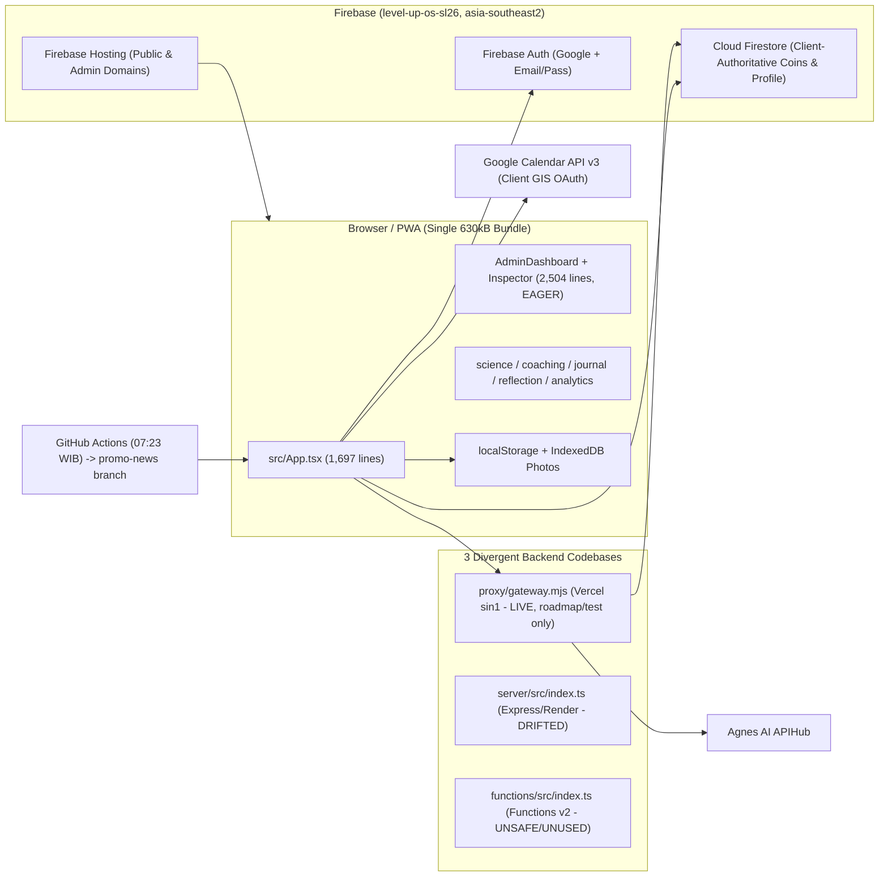

# 03 — Current vs Target Architecture & Firestore Schema Plan

> **Deliverables Covered:** Deliverable #4 (Current vs Target Architecture) & Deliverable #8 (Data Model and Firestore Schema Plan)

---

## 4. Current vs Target Architecture

### 4.1 Current Architecture (v1.x — Audited)



**Core Architectural Bottlenecks Identified in v1.x:**
1. **God Component & Bundle Bloat:** `src/App.tsx` owns all state, sync, routing, and handlers; Admin components load inside every participant's initial bundle.
2. **Client-Trust Security Boundary:** Gameplay progression, coins, and coin ledger entries are written directly from browser SDK to Firestore.
3. **3-Way Proxy Fragmentation:** `proxy/`, `server/`, and `functions/` diverge in auth checks, CORS allowlists, and API schemas.
4. **Monolithic Profile Document:** `users/{uid}/profile/main` mixes immutable identity, volatile daily quests, static career stages, and dead legacy fields in a single document nearing rules-expression ceiling.

---

### 4.2 Target Architecture (LevelUp 2.0)

```mermaid
flowchart TB
  subgraph Clients["Independent LevelUp PWA (Code-Split Lazy Routes)"]
    Shell["App Shell + Feature Flags + Sync Store (<220kB gzip)"]
    Today["/today — Command Center (HUD, Quests, Journal, Coaches)"]
    Roadmap["/roadmap — Dream Map 2.0, Skills & Portfolio"]
    Academy["/academy — LevelUp Academy LMS (Lazy Chunk)"]
    Studio["/studio — Business Studio 16 Tools (Lazy Chunk)"]
    AgnesUI["/hub — Agnes AI 2.0, Wallet, Rewards, Ecosystem"]
    StaffApp["/admin — Role-Scoped Staff/Mentor/Admin Console (Lazy Chunk)"]
    Offline["Workbox SW + Firestore Persistent Cache + IndexedDB"]
  end

  subgraph API["Single Authoritative LevelUp API Service (Cloud Run / Functions v2)"]
    AuthMW["Firebase ID Token + Custom Claims / RBAC Guard"]
    AIGateway["Agnes 2.0 Orchestrator (10 Modes + Consent/PII Filter)"]
    EconomySvc["Coin & Wallet Service (Server Minting, Idempotency, Ledger, Reconciliation)"]
    AssessSvc["Competency, Quiz Grading & Certificate Issuer"]
    EcoAPI["Ecosystem Integration Gateway (HMAC-SHA256 Webhooks & REST)"]
  end

  subgraph Data["Firebase Platform (asia-southeast2)"]
    FAuth["Firebase Auth + RBAC Custom Claims"]
    Firestore["Cloud Firestore (v4 Backward-Compatible Schema + Composite Indexes)"]
    FStorage["Cloud Storage (Evidence Artifacts & Certificates - Signed/Scoped)"]
  end

  subgraph External["Independent External Systems (No Shared DB)"]
    SocioWeb["sociopreneur.online (Commerce, Marketplace, Payments, B2B)"]
    Socioline["socioline.sociopreneur.online (Mission Platform)"]
    MyValue["MyValue / Loyalty Partner (Gated Phase 5)"]
    AgnesAPI["Agnes AI APIHub"]
    GCalAPI["Google Calendar API v3"]
  end

  Shell --> Today & Roadmap & Academy & Studio & AgnesUI & StaffApp
  Shell --> Offline
  Shell --> FAuth
  Shell --> Firestore
  Today --> GCalAPI
  Clients --> AuthMW
  AuthMW --> AIGateway & EconomySvc & AssessSvc & EcoAPI
  AIGateway --> AgnesAPI
  EconomySvc --> Firestore
  EconomySvc -. "Phase 5 (Gated)" .-> MyValue
  AssessSvc --> Firestore & FStorage
  EcoAPI <--> SocioWeb
  EcoAPI <--> Socioline
```



### 4.3 Frontend Modularization Plan (Preserving React 19 + Vite + Tailwind)
1. **Decompose `src/App.tsx` into Feature Modules + Context/Hooks:**
   - `src/app/Router.tsx`: Lightweight client router (`window.history` or `wouter`/`react-router-dom`) supporting `/today`, `/roadmap`, `/academy/*`, `/studio/*`, `/hub`, `/admin/*` while preserving `ADMIN_HOST` / `PUBLIC_HOST` domain routing in `src/routes.ts`.
   - `src/state/AuthContext.tsx`, `src/state/PlayerContext.tsx`, `src/state/ConfigContext.tsx`: Isolates auth, cloud sync, feature flags, and coin economy subscriptions cleanly.
   - `React.lazy()` code splitting for: `AdminApp`, `AcademyWorkspace`, `BusinessStudioWorkspace`, `AgnesCopilotWorkspace`, and `Awakening2Wizard`.
   - Update `vite.config.ts` `manualChunks` to separate `firebase`, `admin`, `academy`, `studio`, and `ical` chunks.
2. **Consolidate Backend Into ONE Authoritative Runtime:**
   - **Recommended Production Runtime:** **Firebase Cloud Functions v2 (Node 22, `asia-southeast2`, Blaze plan)** OR **Cloud Run (Node 22 Express, `asia-southeast2`)** using Firebase Admin SDK with native IAM service account (eliminating static refresh-token juggling in Vercel `proxy/gateway.mjs`, eliminating `server/.secrets/` file vault, and placing compute in the exact same Jakarta region as Firestore!).
   - *Interim Bridge (if Spark plan remains temporarily):* Keep `proxy/gateway.mjs` strictly for Agnes AI until Blaze/Cloud Run is approved, while **holding** Phase 4/5 server-authoritative writes behind the backend consolidation gate.
   - Retire divergent `functions/src/index.ts` unsafe routes immediately in Phase 0 once unified backend architecture is approved.

---

## 8. Data Model & Firestore Schema Plan (`schemaVersion: 3 → 4`)

### 8.1 Backward Compatibility Guarantees
- **Zero Breaking Changes to v3 Collections:** Every existing `users/{uid}`, `users/{uid}/profile/main`, `users/{uid}/journal/*`, `users/{uid}/dailyLogs/*`, `users/{uid}/coinTransactions/*`, `users/{uid}/calendar/latest` document continues reading and writing with zero data loss.
- **Additive Evolution:** New v2 profile metadata is strictly **optional** on `profile/main` (`schemaVersion: 4`), while large new domains (**Academy**, **Business Studio**, **Evidence**, **Wallet**, **Consents**) live in **dedicated subcollections and top-level collections** so `profile/main` never approaches Firestore's 1 MiB document size limit or Security Rules expression ceiling.

### 8.2 Extended Participant Schema (`users/{uid}/...`)

#### A. `users/{uid}` (Account Directory & Consent-Filtered Summary)
Keep all 11 required v1 fields; **refactor `telemetry`** (Phase 0 Privacy Remediation):
- **Split `telemetry` into safe non-sensitive coaching summary** (remove private health/mood fields `lastMood`, `lastSleepHours`, `hasPainAlert` from global `users/{uid}` doc; move health alerts to owner-only / explicitly consented `users/{uid}/privacy/wellnessSharing`!).
- Add optional fields:
  - `roles?: string[]` (display mirror only — NEVER trusted by Security Rules!)
  - `cohortIds?: string[]` (assigned cohorts, max 20; server/admin-writable)
  - `institutionId?: string` (optional institutional sponsor scope)
  - `pathwayId?: PathwayId`
  - `progressionSummary?: { experienceLevel: number; competencyLevel: number; businessLevel: number; activeStreak: number; lastActiveDate: string }`

#### B. `users/{uid}/profile/main` (Additive `schemaVersion: 4` Fields)
Keep all existing 37 required + 10 optional v3 fields untouched, plus optional v4 fields:
```ts
export type DevelopmentDimension =
  | 'PURPOSE' | 'HEALTH' | 'SKILLS' | 'CAREER' | 'BUSINESS' | 'FINANCIAL' | 'IMPACT';

export type PathwayId =
  | 'personal_growth' | 'career_accelerator' | 'entrepreneur'
  | 'sociopreneur' | 'community_agriculture' | 'global_business';

// Optional additive fields on PlayerProfile (schemaVersion: 4)
export interface ProfileV4Extension {
  pathwayId?: PathwayId;                     // Default: 'personal_growth'
  purposeStatement?: string;                 // Max 500 chars
  awakeningV2Completed?: boolean;
  availableResources?: string[];             // Non-sensitive tags, max 20
  preferredActiveDays?: number[];            // 0..6
  skillSelfRatings?: Record<string, number>; // 1..5 self-rated ONLY (not verified competency)
  competencyLevel?: number;                  // Server/assessment-derived (1..10)
  competencyPoints?: number;                 // Verified rubric points
  businessLevel?: number;                    // Server/milestone-derived (0..10)
  businessStage?: BusinessStageCode;         // 'idea' | 'discover' | 'prototype' | 'validate' | 'launch' | 'grow' | 'impact'
  activeVentureId?: string | null;
}
```
- **Additive extensions on `Quest` & `DreamStep`:**
  - `Quest`: `dimension?: DevelopmentDimension`, `questSource?: 'manual' | 'checkin_capture' | 'dual_track' | 'academy' | 'studio' | 'mentor'`, `linkedLessonId?: string`, `linkedCanvasId?: string`, `evidenceRequired?: boolean`, `evidenceId?: string`.
  - `DreamStep`: `pathwayId?: PathwayId`, `stageCode?: string` (e.g., `'sociopreneur_06_prototype'`), `dimension?: DevelopmentDimension`, `evidenceRequirement?: string`, `evidenceStatus?: 'none' | 'submitted' | 'approved' | 'revision_requested'`, `linkedCourseIds?: string[]`, `linkedCanvasTypes?: string[]`.

#### C. `users/{uid}/privacy/settings` (NEW — Owner-Only Write, Explicit Consent Controls)
```ts
export interface UserPrivacySettings {
  ownerUid: string;
  shareCoachingProgressWithMentor: boolean;   // Default: true for cohort enrollments
  shareBusinessCanvasesWithMentor: boolean;   // Default: true for cohort enrollments
  shareWellnessWithCoach: boolean;            // Default: FALSE (opt-in only!)
  sharePrivateJournalWithAgnes: boolean;      // Default: FALSE (opt-in only!)
  shareHealthMetricsWithAgnes: boolean;       // Default: FALSE (opt-in only!)
  shareAggregatedImpactWithEcosystem: boolean;// Default: FALSE (opt-in for sociopreneur.online)
  updatedAt: Timestamp;
}
```

#### D. `users/{uid}/wallet/main` & `users/{uid}/walletLedger/{eventKey}` (NEW — Server-Authoritative Economy)
- `users/{uid}/wallet/main`: **Read: Owner & Admin; Write: SERVER ONLY (Admin SDK / Cloud Run).**
  - `{ ownerUid, balance: int, lifetimeEarned: int, lifetimeRedeemed: int, pendingHold: int, lastReconciledAt: Timestamp, lastLedgerSeq: int, status: 'active' | 'frozen' }`
- `users/{uid}/walletLedger/{eventKey}`: **Doc ID = deterministic idempotency key** (e.g., `earn:quest:{uid}:{dateKey}:{questId}` or `partner:myvalue:{partnerTxId}`). **Read: Owner, Admin, Auditor; Write: SERVER ONLY; Update/Delete: `false`.**
  - `{ eventKey, ownerUid, seq, type, source, amount, balanceBefore, balanceAfter, note, partnerRef, idempotencyHash, actorUid, createdAt: Timestamp }`
- *(Legacy `profile/main.gold` becomes a server-mirrored read-only field in Phase 5 after wallet migration so existing UI components never break!)*

#### E. `users/{uid}/evidence/{evidenceId}` (NEW — Portfolio & Milestone Verification Vault)
```ts
export interface EvidenceRecord {
  id: string;
  ownerUid: string;
  dimension: DevelopmentDimension;
  targetType: 'dream_step' | 'quest' | 'assignment' | 'business_milestone' | 'competency';
  targetId: string;
  cohortId?: string | null;
  title: string;
  summary: string;
  evidenceKind: 'reflection' | 'link' | 'file' | 'canvas_snapshot' | 'interview_log' | 'sales_proof';
  artifactUrl?: string;       // Scoped Firebase Storage path or verified HTTPS URL
  metricsJson?: Record<string, number | string>;
  sourceTag: 'validated_evidence'; // Strictly separated from AI assumptions
  reviewStatus: 'draft' | 'submitted' | 'approved' | 'revision_requested';
  reviewerUid?: string;
  reviewerFeedback?: string;
  rubricScore?: number;       // 0..100
  submittedAt?: Timestamp;
  reviewedAt?: Timestamp;
  createdAt: Timestamp;
  updatedAt: Timestamp;
}
```

### 8.3 LevelUp Academy Collections (Top-Level & User-Scoped)

| Collection Path | Ownership & Access | Key Fields |
| --- | --- | --- |
| `courses/{courseId}` | Read: Authenticated (if `published`) or Staff/Trainer; Write: Trainer/Admin | `slug`, `title`, `summary`, `pathwayIds[]`, `dimensions[]`, `competencyIds[]`, `level`, `accessType` (`free` \| `paid_external` \| `cohort_only`), `externalProductId` (maps to `sociopreneur.online`), `status` (`draft` \| `published` \| `archived`), `moduleOrder[]` |
| `courses/{courseId}/modules/{moduleId}` | Read: Enrolled or Published preview; Write: Trainer/Admin | `order`, `title`, `description`, `lessonOrder[]`, `linkedDreamStageCode?`, `linkedCanvasType?` |
| `courses/{courseId}/modules/{moduleId}/lessons/{lessonId}` | Read: Enrolled (or `isPreview: true`); Write: Trainer/Admin | `order`, `title`, `type` (`article` \| `video` \| `quiz` \| `assignment` \| `studio_action`), `contentMd`, `videoUrl?`, `estimatedMinutes`, `quizSpec?` (questions without answer keys in public read; answer keys in `quizKeys/{lessonId}` server-only!), `assignmentRubric?`, `autoQuestTemplate?` |
| `cohorts/{cohortId}` | Read: Members, assigned Mentors/Trainers, Admin, scoped Institution; Write: Admin/Trainer | `name`, `courseIds[]`, `pathwayId`, `startDate`, `endDate`, `mentorUids[]`, `trainerUids[]`, `institutionId?`, `status` |
| `enrollments/{uid}_{courseId}` | Read: Owner, assigned Cohort Mentor/Trainer, Admin; Write: **SERVER ONLY** (free enroll endpoint, Admin grant, or `sociopreneur.online` purchase webhook) | `uid`, `courseId`, `cohortId?`, `source` (`free` \| `sociopreneur_order` \| `cohort_grant`), `externalOrderId?`, `status` (`active` \| `completed` \| `revoked_refund` \| `expired`), `completedLessonIds[]`, `progressPct`, `enrolledAt`, `revokedAt?` |
| `submissions/{submissionId}` | Read: Owner, assigned Cohort Mentor/Trainer, Admin; Create/Update draft: Owner; Grade/Review: Mentor/Trainer/Admin (server-verified) | `uid`, `courseId`, `lessonId`, `cohortId?`, `type` (`quiz` \| `assignment`), `answersJson?`, `evidenceId?`, `score?`, `passed`, `status` (`submitted` \| `graded` \| `revision_requested`), `feedback?`, `gradedBy?` |
| `certificates/{certificateCode}` | Public read of verification summary (`certificateCode`, `holderName`, `courseTitle`, `competencies[]`, `issuedAt`, `status`); Write: **SERVER ONLY** | `certificateCode`, `uid`, `courseId`, `cohortId?`, `competencyIds[]`, `evidenceIds[]`, `issuedAt`, `revokedAt?`, `verificationHash` |
| `competencies/{competencyId}` | Read: Authenticated; Write: Admin/Trainer | `code`, `name`, `dimension`, `tier` (`foundational` \| `practitioner` \| `builder` \| `leader`), `requiredEvidenceCount`, `requiredCourseIds[]` |
| `users/{uid}/competencies/{competencyId}` | Read: Owner, Cohort Mentor, Admin; Write: **SERVER ONLY** | `competencyId`, `status` (`in_progress` \| `verified`), `verifiedEvidenceIds[]`, `verifiedBy`, `verifiedAt` |

### 8.4 Business Studio Collections (`users/{uid}/ventures/{ventureId}/...`)

| Collection Path | Key Fields |
| --- | --- |
| `users/{uid}/ventures/{ventureId}` | `ownerUid`, `name`, `sector`, `pathwayId`, `cohortId?`, `businessStage` (`idea`..`impact`), `businessLevel` (`0..10`), `marketplaceStatus` (`not_submitted` \| `submitted` \| `approved` \| `listed` \| `rejected`), `externalProductId?`, `summary`, `createdAt`, `updatedAt` |
| `users/{uid}/ventures/{ventureId}/canvases/{canvasType}` | Doc ID = one of the 16 tool IDs (e.g., `social_problem`, `bmc`, `vpc`, `hpp_pricing`, `cash_flow`, `bep`, `legal_readiness`, `export_readiness`, `social_impact`). Stores structured `blocks[]` where **every item carries `origin: 'user_input' | 'ai_assumption' | 'validated_evidence'`**, optional `linkedEvidenceIds[]`, deterministic `computedMetrics` (for HPP/BEP/CashFlow), and `generatedQuestTemplates[]`. |
| `users/{uid}/ventures/{ventureId}/experiments/{expId}` | `hypothesis`, `targetMetric`, `sampleSize`, `status` (`planned` \| `running` \| `validated` \| `invalidated` \| `pivoted`), `origin`, `evidenceIds[]`, `learnings`, `nextAction` |
| `users/{uid}/ventures/{ventureId}/marketFeedback/{eventId}` | Server-written from `sociopreneur.online` webhooks: `orderCount`, `revenueIdr`, `repeatRate`, `customerRating`, `b2bInquiryCount`, `periodKey` |

### 8.5 Platform Config, Feature Flags & Integration Collections
- `appConfig/featureFlags`: `{ awakeningV2: bool, pathways: bool, academy: bool, businessStudio: bool, agnesV2: bool, serverWallet: bool, myValueRedemption: bool, ecosystemSync: bool, cohortAllowlist: string[] }` (Read: Authenticated; Write: Admin).
- `integrationEvents/{eventId}`: **SERVER ONLY** (Admin/Auditor read) — idempotent inbound/outbound webhook log for `sociopreneur.online` & `socioline.sociopreneur.online` (`direction`, `eventType`, `externalEventId`, `hmacVerified`, `status`, `retryCount`, `payloadHash`, `processedAt`).

### 8.6 Required Composite Indexes (`firestore.indexes.json`)
Currently empty (`[]`). LevelUp 2.0 requires declaring these composite indexes before Phase 2+:
1. `enrollments`: `(uid ASC, status ASC, enrolledAt DESC)` and `(cohortId ASC, status ASC)`
2. `submissions`: `(cohortId ASC, status ASC, submittedAt ASC)` (Mentor Review Queue!) and `(uid ASC, courseId ASC)`
3. `users/{uid}/evidence`: `(reviewStatus ASC, submittedAt DESC)` and `(dimension ASC, reviewStatus ASC)`
4. `users/{uid}/walletLedger`: `(ownerUid ASC, seq DESC)` and `(type ASC, createdAt DESC)`
5. `courses`: `(status ASC, pathwayIds ARRAY_CONTAINS, updatedAt DESC)`
6. `integrationEvents`: `(status ASC, createdAt DESC)`
