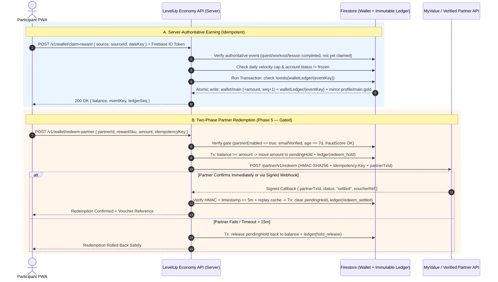

# 05 — Security, Privacy, Coin Economy & Ecosystem Integration API Contracts

> **Deliverables Covered:** Deliverable #13 (Security and Privacy Improvement Plan — Stage 10) & Deliverable #14 (Ecosystem Integration API Contracts — Stage 11)
>
> **Planning Stage Boundary:** This document specifies target security rules, RBAC policies, server-authoritative economy controls, and integration API contracts. **No production `firestore.rules`, backend code, secrets, or deployment configs have been modified.** Future edits to `firestore.rules` must be authored and verified against the Firebase Emulator Suite prior to any deployment.

---

## 13. Security, Privacy & Coin Economy Improvement Plan (Stage 10)

### 13.1 Audited Security & Configuration Remediation Matrix

Our read-only audit (`01-existing-system-audit-and-inventory.md`) uncovered five concrete security vulnerabilities (`SEC-01` through `SEC-05`) plus client-config and secret-handling hygiene gaps. Every finding maps to a mandatory remediation phase:

| ID | Severity | Audited Finding (Code Evidence) | Remediation Plan | Target Phase |
| --- | --- | --- | --- | --- |
| **SEC-01** | **CRITICAL** | `firestore.rules:762-765` permits owners to write `profile/main.gold` (`0..10,000,000`), `level`, `exp`, `streak`; `firestore.rules:804-810` permits owners to create `earn` entries in `coinTransactions` up to `1,000,000` with zero server verification or idempotency. | Introduce server-authoritative `users/{uid}/wallet/main` and immutable `users/{uid}/walletLedger/{eventKey}`. Mint/redeem exclusively via authenticated backend endpoints with deterministic idempotency keys, daily velocity caps, and daily ledger reconciliation. Lock `profile/main.gold` to server-mirror-only in Phase 5. | Phase 0 (freeze monetary activation) → Phase 5 (full cutover) |
| **SEC-02** | **CRITICAL** | `firestore.rules:257, 722, 757, 778, 823` allows any `isStaff()` (`admin`, `operator`, AND `auditor`) to read every user's private `journal/*` (mood, sleep, meals, pain), `dailyLogs/*`, `calendar/latest`, and `profile/main`. Global `users/{uid}.telemetry` exposes `lastMood`, `lastSleepHours`, and `hasPainAlert` to `isStaff()` and `isAIProxy()`. | Enforce strict **4-tier Data Classification** and `users/{uid}/privacy/settings` consent document (all sensitive sharing `false` by default). Strip health/mood fields from `users/{uid}.telemetry`. Restrict `journal/*` and `calendar/latest` to **Owner-only** (plus explicit opt-in coaching summary where consented). Replace flat `isStaff()` with 8 least-privilege roles. | Phase 0 |
| **SEC-03** | **HIGH** | `functions/src/index.ts` uses `cors({ origin: true })`, forwards arbitrary client `req.body.messages`, accepts unvalidated `req.body.baseUrl` on `/api/admin/test-ai` (SSRF risk), performs non-atomic quota updates, ignores `adminEmails/{email}`, and uses an outdated request schema incompatible with `aiService.ts`. | Decommission/quarantine `functions/src/index.ts` (with explicit approval). Consolidate onto one authoritative API runtime with strict origin allowlist, structured task-only AI endpoints (no raw message passthrough), hardcoded upstream AI endpoint allowlist (eliminating SSRF), and atomic Firestore transactions for quotas. | Phase 0 |
| **SEC-04** | **HIGH** | 3-way backend drift across `proxy/gateway.mjs` (live Vercel, missing `/api/admin/config` & `/api/admin/usage-logs`), `server/src/index.ts` (ignores `adminEmails/{email}`), and `render.yaml` (omits `levelup.sociopreneur.online` & `go-levelup.sociopreneur.online` from `ALLOWED_ORIGINS`). | Adopt a single authoritative Node 22 backend (recommended: **Cloud Run / Cloud Functions v2 in `asia-southeast2`** co-located with Firestore) using native GCP IAM service account and Secret Manager. Retire duplicate runtimes after parity verification. | Phase 0 (decision) → Phase 4 (full cutover) |
| **SEC-05** | **MEDIUM** | Bootstrap admin email `stefenlaksana.sl@gmail.com` hardcoded in 4 files (`firestore.rules`, `firebaseService.ts`, `server/src/index.ts`, `functions/src/index.ts`); dual legacy `admins/{uid}` + `adminEmails/{email}` lookup increases rule complexity and drift. | Migrate to **Firebase Auth Custom Claims** (`roles[]`, `cohortIds[]`, `institutionId`, `rbacVersion`) synced from an authoritative `staffRoles/{uid}` collection managed by `super_admin`. Remove hardcoded email literals once break-glass Super Admin recovery runbook is verified (requires explicit approval). | Phase 0 |

#### Client-Side Configuration & Secret Management Audit
1. **Firebase Web Config (`VITE_FIREBASE_*`):** Public client identifiers by design; safe **only** when paired with strict Firestore Security Rules, authorized Auth domains (`levelup.sociopreneur.online`, `go-levelup.sociopreneur.online`), and **Firebase App Check** (reCAPTCHA Enterprise / v3) enabled in Phase 0/4 to curb API abuse.
2. **Google OAuth Client ID (`VITE_GOOGLE_CLIENT_ID`):** Public OAuth identifier for GIS token flow. Restrict Authorized JavaScript Origins strictly to production domains (plus localhost in dev) in Google Cloud Console; verify `calendar.events.owned.readonly` production OAuth consent screen so public non-test users do not hit Google's "unverified app" block.
3. **Server Secrets (`adminSecrets/ai`, `adminSecrets/coinPartner`, `proxy/.env`, `server/.secrets/`):**
   - **Current Risk:** `adminSecrets/ai` and `adminSecrets/coinPartner` store API keys in Firestore readable by Admins (meaning any compromised Admin browser session could exfiltrate raw partner/AI API keys); `proxy/gateway.mjs` relies on long-lived Firebase OAuth refresh token env vars; `server/` uses a local file-based vault.
   - **Target State:** Store all runtime secrets (Agnes AI API key, HMAC webhook signing secrets for `sociopreneur.online` / `socioline.sociopreneur.online`, MyValue partner credentials) in **GCP Secret Manager** (or platform-encrypted server-only env vars) with **write-only secret rotation** from the Admin Console (Admin submits new secret to server endpoint → server writes to Secret Manager and stores only `{ configured: true, lastFour: '****', rotatedAt, rotatedBy }` in Firestore). Never return raw API keys to the browser. Rotate partner & AI secrets every 90 days.

---

### 13.2 Data Privacy Classification & Indonesian PDP Law (UU No. 27/2022) Alignment

Because LevelUp captures sleep, mood, meals, pain areas, personal reflections, and Google Calendar events alongside learning and business records, LevelUp 2.0 adopts **Privacy by Default** aligned with Indonesia's Personal Data Protection Law (UU PDP No. 27/2022) and GDPR minimization principles:

| Tier | Classification | Collections / Fields | Default Visibility | External / AI Sharing Policy |
| --- | --- | --- | --- | --- |
| **Tier 1** | **Strictly Private Personal & Health Data** | `users/{uid}/journal/*`, `users/{uid}/dailyLogs/*` (wellness fields), `users/{uid}/calendar/latest`, health/mood attributes | **Owner ONLY** (`uid == auth.uid`). **Denied** to `admin`, `operator`, `auditor`, `mentor`, `trainer`, `institution_viewer`. | **NEVER** sent to `sociopreneur.online` or `socioline.sociopreneur.online`. Excluded from Agnes AI prompts unless user explicitly toggles `sharePrivateJournalWithAgnes` or `shareHealthMetricsWithAgnes` (default `false`) in `users/{uid}/privacy/settings`, and only for the specific Wellness/Coach mode. |
| **Tier 2** | **Learning, Coaching & Venture Workspace** | `users/{uid}/profile/main` (non-health), `users/{uid}/evidence/*`, `users/{uid}/ventures/*`, `enrollments/*`, `submissions/*`, `users/{uid}/competencies/*` | Owner + explicitly assigned cohort `mentor`/`trainer` (scoped by `cohortId` AND user's consent flag) + `admin`/`super_admin` (logged access). | Shared with Agnes AI only for active workspace context (redacting PII). Venture product data shared with `sociopreneur.online` **only** upon explicit founder "Submit Product" action. |
| **Tier 3** | **Financial Ledger, Security & Operational Audit** | `users/{uid}/wallet/main`, `users/{uid}/walletLedger/*`, `aiUsageLogs/*`, `integrationEvents/*`, `staffRoles/*` | Owner reads own wallet/ledger. `auditor` reads anonymized/operational audit & ledger integrity logs (**no private journal content**). `admin`/`super_admin` manages system config. | Only transaction references (`partnerRef`, `amount`, `eventKey`) exchanged with verified redemption partner in Phase 5. |
| **Tier 4** | **Public Catalog & Consented Aggregated Impact** | `courses/*` (published), `certificates/{code}` (verification card), consented venture impact summaries, aggregated cohort impact (`k >= 5`) | Authenticated learners (or public for certificate verification summary). | Shareable with `sociopreneur.online` / `socioline.sociopreneur.online` via signed API contracts. |

**Consent & Data Subject Rights Built Into LevelUp 2.0:**
- **Explicit Consent Controls:** `users/{uid}/privacy/settings` exposed in Participant Profile → Privacy & Consent drawer; every sensitive flag defaults to `false`.
- **No Unnecessary Sensitive Collection in Awakening 2.0:** Onboarding never requires medical history, exact income, bank account details, or NIK/KTP.
- **Data Export & Account Deletion:** Self-service JSON export of user's own profile/journals/canvases and account deletion workflow (anonymizing immutable financial/certificate audit records while purging Tier 1 private journals within 30 days).

---

### 13.3 Least-Privilege RBAC Design (8 Roles)

Replace the monolithic `isStaff()` check with 8 explicit roles carried in **Firebase Auth Custom Claims** (synced server-side from `staffRoles/{uid}`):

| Role | Primary Purpose | Scope Limitation | Private Journals / Calendar? |
| --- | --- | --- | --- |
| `learner` | Default participant account | Own `users/{uid}/**` only | Own data only |
| `mentor` | Coaches participants, reviews evidence & venture canvases | Strictly scoped to `cohortIds` in token claim (`cohortId in request.auth.token.cohortIds`) | **NO** (unless `shareWellnessWithCoach == true` exposes non-journal wellness summary only; never raw journal text/calendar) |
| `trainer` | Authors/maintains Academy courses, modules, lessons, rubrics; grades cohort assignments | Assigned courses & `cohortIds` | **NO** |
| `institution_viewer` | Sponsoring university, NGO, cooperative, or government partner monitoring program KPIs | Read-only aggregated dashboards & cohorts where `cohort.institutionId == auth.token.institutionId` | **NO** (strictly aggregated KPIs & verified progress; zero private journals/health/calendar) |
| `operator` | Support & operations staff (promo news, cohort enrollment ops, non-financial support) | Operational config & user account directory (`users/{uid}` non-health metadata) | **NO** |
| `auditor` | Compliance, security, and financial integrity verification | **Strictly Read-Only** across `walletLedger`, `aiUsageLogs`, `integrationEvents`, `staffRoles`, `appConfig` | **NO** (never reads `journal/*`, `calendar/latest`, or raw AI prompt text containing user notes) |
| `admin` | Platform administrator managing courses, cohorts, feature flags, coin economy rules, AI config | Platform configuration & support management (writes audited to `adminAuditLogs`) | **NO** (Tier 1 journals/calendar stay owner-only; emergency legal/safety export requires break-glass dual-logged process, not casual dashboard browsing!) |
| `super_admin` | Root governance role managing `staffRoles`, custom claims, secret rotation, and break-glass recovery | Full RBAC governance | **NO** direct dashboard browse of Tier 1 journals |

#### Complete Firestore Collection Access Matrix (Target v4 Rules Specification)

| Collection Path | `learner` (Owner) | `mentor` (In Cohort) | `trainer` (In Cohort/Course) | `institution_viewer` (In Inst.) | `operator` | `auditor` | `admin` / `super_admin` | Server (Admin SDK) |
| --- | --- | --- | --- | --- | --- | --- | --- | --- |
| `users/{uid}` | R / limited U | R (if cohort match) | R (if cohort match) | — (via cohort stats) | R / limited U | R (metadata only) | R / U | Full |
| `users/{uid}/profile/main` | R / U (non-authoritative fields only in Ph5) | R (non-health projection) | R (non-health projection) | — | — | — | R (support, audited) | Full |
| `users/{uid}/privacy/settings` | **R / W** | — | — | — | — | R (consent flags audit) | R | Full |
| `users/{uid}/journal/*` | **R / W** | **DENY** | **DENY** | **DENY** | **DENY** | **DENY** | **DENY** | Consent-checked read only |
| `users/{uid}/calendar/latest` | **R / W** | **DENY** | **DENY** | **DENY** | **DENY** | **DENY** | **DENY** | DENY (client-only) |
| `users/{uid}/dailyLogs/*` | **R / W** | **DENY** (summary only if opted-in) | **DENY** | **DENY** | **DENY** | **DENY** | **DENY** | Consent-checked read |
| `users/{uid}/evidence/*` | R / C / U (draft) | R (cohort match) | R (cohort match) | — | — | R (approved portfolio) | R | Full (grade/approve) |
| `users/{uid}/ventures/**` | R / W | R (cohort + consent) | R (cohort + consent) | — | — | — | R (support) | Full (marketFeedback, businessLevel) |
| `users/{uid}/wallet/main` | R | — | — | — | — | R | R | **Exclusive W** |
| `users/{uid}/walletLedger/*` | R | — | — | — | — | R | R | **Exclusive C (Immutable: U/D DENY)** |
| `courses/**` (excl. `quizKeys`) | R (if published/enrolled) | R | R / W (assigned) | R | R | R | R / W | Full |
| `quizKeys/{lessonId}` | **DENY** | **DENY** | W (via server) | **DENY** | **DENY** | **DENY** | **DENY** | **Exclusive R / W** |
| `cohorts/{cohortId}` | R (if member) | R (assigned) | R / U (assigned) | R (`institutionId` match) | R / U | R | R / W | Full |
| `enrollments/{id}` | R | R (cohort match) | R (cohort match) | R (cohort in inst.) | R | R | R | **Exclusive W** |
| `submissions/{id}` | R / C / U (draft) | R (cohort match) | R (cohort match) | — | — | R | R | **Exclusive Grading W** |
| `certificates/{code}` | R (public verify summary) | R | R | R | R | R | R | **Exclusive W** |
| `appConfig/*` | R (public flags/economy) | R | R | R | R / limited U | R | R / W | Full |
| `adminSecrets/*` | **DENY** | **DENY** | **DENY** | **DENY** | **DENY** | **DENY** | **DENY** (metadata only) | **Exclusive (Secret Manager)** |
| `staffRoles/{uid}` | R (self) | R (self) | R (self) | R (self) | R (self) | R | R / (`super_admin` W) | Full |
| `aiUsageLogs/*` & `integrationEvents/*` | **DENY** | **DENY** | **DENY** | **DENY** | R (ops errors) | R | R | **Exclusive W** |

#### Proposed `firestore.rules` Architectural Diff Specification (For Phase 0 Implementation)
> **Implementation Reminder:** Do **NOT** apply directly in this planning phase. In Phase 0, delegate authoring to `firestore-rules-author` and validate every rule with 200+ Firebase Emulator tests.

Key rule changes from current `firestore.rules` (856 lines):
1. **Replace `isStaff()` with claim-based helpers:**
   - `hasRole(role)` checks `request.auth != null && request.auth.token.roles is list && role in request.auth.token.roles`.
   - `isCohortMentor(cohortId)` checks `hasRole('mentor') && request.auth.token.cohortIds is list && cohortId in request.auth.token.cohortIds`.
   - Keep a temporary feature-flagged transition bridge reading `adminEmails/{email}` ONLY during Migration M3, then remove.
2. **Enforce Tier 1 Owner-Only Isolation:**
   - `match /users/{userId}/journal/{docId}` → `allow read, write: if isOwner(userId) && isValidJournal(...)` (REMOVE `isStaff()`).
   - `match /users/{userId}/calendar/latest` → `allow read, write: if isOwner(userId)` (REMOVE `isStaff()`).
   - `match /users/{userId}/dailyLogs/{dateKey}` → `allow read, write: if isOwner(userId)` (REMOVE `isStaff()`).
3. **Lock Authoritative Progression & Wallet Subcollections:**
   - `match /users/{userId}/wallet/main` → `allow read: if isOwner(userId) || hasRole('admin') || hasRole('auditor'); allow write: if false;` (Admin SDK bypasses rules).
   - `match /users/{userId}/walletLedger/{eventKey}` → `allow read: if isOwner(userId) || hasRole('admin') || hasRole('auditor'); allow create, update, delete: if false;`.
   - In Phase 5, freeze `profile/main.gold`, `profile/main.competencyLevel`, `profile/main.businessLevel` from client mutation by requiring `request.resource.data.gold == resource.data.gold` on owner updates (while Server Admin SDK updates the mirrored display value atomically).
4. **Stay Well Below Firestore's 1,000-Expression Rule Ceiling:**
   - Keep `profile/main` validator concise by moving new LevelUp 2.0 domains (`evidence`, `ventures`, `wallet`, `privacy`, `competencies`) into separate subcollections rather than bloating `profile/main`.

---

### 13.4 AI Proxy Security & Abuse Hardening
1. **Strict Origin & Token Enforcement:** Accept CORS strictly from `https://levelup.sociopreneur.online` and `https://go-levelup.sociopreneur.online` (plus localhost in non-prod). Require valid Firebase ID Token (`verifyIdToken(token, /* checkRevoked */ true)`) and Firebase App Check token (`X-Firebase-AppCheck`).
2. **Eliminate Arbitrary Prompt Relay & SSRF:**
   - Remove generic `messages[]` forwarding; all AI endpoints accept structured mode-specific DTOs (`{ mode, action, targetId, userPrompt }`) and build system prompts server-side.
   - Replace arbitrary `baseUrl` testing in `/api/admin/test-ai` with an explicit server-side allowlist of approved AI provider hosts (e.g., `api.agnes-ai.com` / configured provider registry); block RFC1918 private IPs, `169.254.169.254` metadata endpoints, and `localhost`.
3. **Atomic Quotas & Audit Hygiene:**
   - Increment daily per-user AI quota inside a Firestore Transaction before invoking upstream AI.
   - Log only metadata (`uid`, `mode`, `tokensIn`, `tokensOut`, `latencyMs`, `status`, `piiRedacted: true`) in `aiUsageLogs/*` — **never** log raw private journal text or user health notes.

---

### 13.5 Server-Authoritative Coin Economy & MyValue Security Architecture

#### Why Current Coin Economy Is a Hard NO-GO for Real Value
In v1.x (`firestore.rules:762-810` & `firebaseService.ts:1049-1091`), the browser client calculates coin rewards, increments `profile/main.gold`, and directly writes `users/{uid}/coinTransactions/{id}`. Any authenticated user can open DevTools and grant themselves 1,000,000 coins in one second. **Connecting MyValue or any real-value merchant redemption to client-writable coins would result in immediate financial fraud.**

#### Target Server-Authoritative Coin & Partner Redemption Flow



#### Six Mandatory Coin Economy Controls
1. **Server-Authoritative Reward Issuance:**
   - Every earning event (`quest_complete`, `workout_complete`, `lesson_complete`, `milestone_approved`, `admin_adjustment`) is issued exclusively by the backend API after verifying the underlying completion record in Firestore (e.g., server checks that `questId` exists on `dateKey`, is marked completed, and has not already been minted).
   - Default unit rate stays disciplined (`1 coin` per verified quest/workout action, matching Admin-configurable `appConfig/coinEconomy`), preventing inflation.
2. **Deterministic Idempotency Keys:**
   - Every ledger write uses a deterministic Firestore document ID `eventKey`:
     - Quest: `earn:quest:{uid}:{dateKey}:{questId}`
     - Workout: `earn:workout:{uid}:{dateKey}`
     - Lesson: `earn:lesson:{uid}:{courseId}:{lessonId}`
     - Evidence Milestone: `earn:milestone:{uid}:{evidenceId}`
     - Partner Redemption: `redeem:{partnerId}:{uid}:{clientIdempotencyKey}`
     - Admin Adjustment: `admin:adj:{adminUid}:{ticketId}:{uid}` (requires non-empty `reason` & `ticketId`, logged to `adminAuditLogs`)
   - Because Firestore transactions atomically reject duplicate creation of the same document ID, network retries, double-clicks, and replay attacks **cannot** double-mint or double-debit.
3. **Immutable Append-Only Ledger (`users/{uid}/walletLedger/{eventKey}`):**
   - Firestore rules forbid all client `create`/`update`/`delete`; backend code enforces append-only semantics with monotonic `seq`, `balanceBefore`, `balanceAfter`, and `prevEntryHash` (`SHA-256(prevHash + eventKey + amount + balanceAfter)`).
   - Corrections never edit historical entries; they append an explicit compensating `reversal` or `admin_adjustment` entry.
4. **Automated Daily Balance Reconciliation:**
   - Scheduled Cloud Job runs daily at `02:00 WIB` across all wallets active in the last 48 hours (plus full weekly sweep):
     - Computes `expectedBalance = SUM(walletLedger.amount)` and validates `walletLedger` sequence continuity & hash chain.
     - Asserts `expectedBalance == wallet.balance + wallet.pendingHold`.
     - On any discrepancy > 0: immediately sets `wallet.status = 'frozen'`, halts redemptions for that UID, writes a P1 incident record to `reconciliationReports/{dateKey}`, and alerts Super Admin / Auditor.
5. **Fraud Prevention & Velocity Guardrails:**
   - **Daily Earning Cap:** Hard server ceiling (configurable, default `20 coins/day` across quests + workouts + lessons) regardless of how many quests a user creates and completes.
   - **Minimum Activity & Account Maturity Gate for Redemption:** Email verified (`email_verified == true`), account age >= 7 days, >= 3 distinct active days before first monetary redemption.
   - **Velocity & Anomaly Detection:** Flag accounts creating/completing >10 quests within 60 seconds, rapid multi-account bursts from identical IP/subnet, or repetitive identical quest titles; auto-hold redemptions above configurable coin threshold for manual review.
   - **Per-User & Platform Circuit Breakers:** Global `appConfig/coinEconomy.dailyGlobalRedemptionCap` auto-pauses partner redemptions if daily platform outflow exceeds budget.
6. **Verified Partner Transactions & Webhook Security (MyValue):**
   - Partner credentials stored exclusively in GCP Secret Manager (migrated out of client-readable `adminSecrets/coinPartner`).
   - Outbound partner requests signed with HMAC-SHA256 + `Idempotency-Key` + TLS 1.3.
   - Inbound partner webhooks MUST pass: (a) constant-time HMAC-SHA256 verification over raw request body, (b) `|now - timestamp| <= 300s`, (c) replay dedup check in `integrationEvents/{partnerEventId}`, and (d) IP allowlist if partner provides static egress IPs.

#### Mandatory Pre-Monetary-Redemption Go-Live Gate Checklist (ALL 10 MUST PASS)
Monetary / MyValue redemption (`appConfig/featureFlags.myValueRedemption` & `appConfig/coinEconomy.partnerEnabled`) MUST remain **`false`** until every single item below is signed off:

- [ ] **Gate 1:** Client direct writes to `profile/main.gold`, `wallet/*`, `walletLedger/*`, and `coinTransactions/*` are completely blocked in deployed `firestore.rules` and verified by automated emulator tests.
- [ ] **Gate 2:** Existing v1 balances are migrated cleanly via `M4` opening-balance ledger entries with 100% reconciliation pass (`drift == 0`).
- [ ] **Gate 3:** Idempotency stress test passes (50 concurrent duplicate claim/redeem requests produce strictly 1 ledger entry).
- [ ] **Gate 4:** Automated daily balance reconciliation job has run cleanly for >= 14 consecutive days in staging/production shadow mode with zero unresolved discrepancies.
- [ ] **Gate 5:** Fraud velocity controls (daily cap, minimum account maturity, anomaly freeze, global redemption circuit breaker) are active and tested.
- [ ] **Gate 6:** Partner (MyValue) sandbox end-to-end tests pass for success, timeout/hold-release, partial failure, duplicate webhook replay, and invalid HMAC rejection.
- [ ] **Gate 7:** Partner API keys & HMAC secrets reside exclusively in server-side Secret Manager (zero secrets in `VITE_*` or browser-readable Firestore).
- [ ] **Gate 8:** Independent adversarial security review / penetration test of Wallet API, Firestore rules, and Webhook handlers reports zero open Critical/High vulnerabilities.
- [ ] **Gate 9:** Legal/Finance sign-off on coin-to-rupiah/point conversion rate, tax/liability accounting, expiry rules, and refund/dispute SOP.
- [ ] **Gate 10:** Written operational Go-Live approval signed by Product Owner, Engineering Lead, and Finance/Operations Owner.

---

## 14. Ecosystem Integration API Contracts (Stage 11)

### 14.1 System Boundaries & Non-Negotiable Architecture Rules

LevelUp operates as an **independently deployed application** (`https://levelup.sociopreneur.online`, repo `slaks37/level-up-Project`, Firebase project `level-up-os-sl26`). There is **NO shared database** and **NO monorepo** with parent or sibling platforms:

| Platform | Domain | Authoritative Ownership | Never Owns / Never Receives |
| --- | --- | --- | --- |
| **Sociopreneur Commerce & Brand** | `https://sociopreneur.online` | Public brand site, product catalog, course sales & checkout, payment processing, marketplace orders, international B2B inquiries, seller payouts | Private user journals, health/sleep/mood/pain logs, personal calendar events, internal draft canvases |
| **LevelUp 2.0 (This Repo)** | `https://levelup.sociopreneur.online` & `https://go-levelup.sociopreneur.online` | Human development OS, Awakening 2.0, 7 Dimensions, Gamification, LMS course delivery & enrollment access, assessments, coaching, Business Studio, product readiness, portfolio, incubation | Payment card processing, shopping cart checkout, marketplace logistics/shipping, buyer PII |
| **Socioline (Mission Platform)** | `https://socioline.sociopreneur.online` | Ecosystem mission campaigns, community impact showcase, collective social impact programs | Individual private journals, health logs, unconsented venture financial records |

### 14.2 Common Integration Transport, Security & Identity Protocol

All server-to-server integration calls between `sociopreneur.online`, `socioline.sociopreneur.online`, and LevelUp's unified API (`https://api.levelup.sociopreneur.online/v1/integrations/...`) obey one uniform security envelope:

1. **Authentication & Signing Headers (Required on every request):**
   - `Content-Type: application/json`
   - `X-Socio-Client`: Caller identifier (`sociopreneur-web` | `socioline-platform` | `levelup-os`)
   - `X-Socio-Key-Id`: Active signing key version (supports zero-downtime key rotation, e.g., `k_2026_q4`)
   - `X-Socio-Timestamp`: Unix epoch seconds (UTC). Receiver **MUST reject** requests where `|serverNow - timestamp| > 300` seconds (`401 TIMESTAMP_EXPIRED`).
   - `X-Socio-Idempotency-Key`: Globally unique event ID (e.g., `ord_99812_enroll_v1`). Receiver stores in `integrationEvents/{idempotencyKey}` and returns the cached `200/201` result on safe retries.
   - `X-Socio-Signature`: `v1=<hex(HMAC_SHA256(sharedSecret, X-Socio-Timestamp + "." + rawRequestBody))>` verified using timing-safe comparison (`crypto.timingSafeEqual`).
2. **Identity Linking Without Shared Auth DB:**
   - Primary cross-system correlation key: **verified normalized email** (`emailLower`) paired with an optional opaque **`ecosystemUserId`** (issued once a user links their account via a short-lived signed deep-link token or matching verified email).
   - If a buyer purchases a course on `sociopreneur.online` before creating a LevelUp account, LevelUp stores a `pendingEnrollments/{sha256(emailLower)}_{courseId}` entitlement record; the moment the buyer signs in to LevelUp with that verified email (Google Auth or verified Email/Password), LevelUp automatically claims and activates the enrollment!
3. **Standard Error Response Envelope:**
```json
{
  "error": {
    "code": "INVALID_SIGNATURE | COURSE_NOT_FOUND | CONSENT_REQUIRED | RATE_LIMITED | INTERNAL_ERROR",
    "message": "Human-readable diagnostic message (no stack traces or secrets)",
    "retryable": true,
    "requestId": "req_01JXYZ..."
  }
}
```
4. **Retry & Dead-Letter Policy:**
   - Retries on `429`, `500`, `502`, `503`, `504`, or network timeout with exponential backoff: `1m → 5m → 15m → 1h → 6h` (5 attempts).
   - Non-retryable `400/401/403/404/422` immediately move to `integrationEvents` with `status: "failed_permanent"` and trigger an Admin Ops alert for manual reconciliation.

---

### 14.3 Contract 1: Verified Course Purchase → LevelUp Enrollment

- **Direction:** `sociopreneur.online` → LevelUp API
- **Endpoint:** `POST /v1/integrations/enrollments`
- **Trigger:** Payment gateway confirms `PAID` / `SETTLED` status on `sociopreneur.online` (never triggered on unpaid/pending checkout).
- **Idempotency Key:** `enroll:{externalOrderId}:{externalCourseId}`

**Request Payload:**
```json
{
  "eventId": "evt_ord_20261127_001",
  "externalOrderId": "SO-2026-009482",
  "paymentVerifiedAt": "2026-11-27T08:15:00Z",
  "buyer": {
    "ecosystemUserId": "soc_usr_88421",
    "email": "budi.santoso@example.com",
    "displayName": "Budi Santoso"
  },
  "course": {
    "externalProductId": "course-sociopreneur-blueprint-01",
    "levelupCourseId": "crs_socio_blueprint_01",
    "cohortId": "coh_2026_batch4"
  },
  "access": {
    "tier": "cohort_mentored",
    "expiresAt": null
  }
}
```

**Success Response (`201 Created` or `200 OK` on idempotent replay):**
```json
{
  "status": "enrolled",
  "enrollmentId": "uid_abc123_crs_socio_blueprint_01",
  "activationState": "active",
  "levelupUid": "uid_abc123",
  "deepLinkUrl": "https://levelup.sociopreneur.online/academy/crs_socio_blueprint_01",
  "processedAt": "2026-11-27T08:15:02Z"
}
```
*(If the buyer does not yet have a LevelUp account, `status` returns `"pending_account_claim"`, `activationState: "pending_email_verification"`, `levelupUid: null`, and `deepLinkUrl` points to `/auth?claim=SO-2026-009482`.)*

**Side Effects in LevelUp:**
- Creates/updates `enrollments/{uid}_{courseId}` with `source: 'sociopreneur_order'`, `status: 'active'`, `externalOrderId`.
- If `cohortId` is present, appends `cohortId` to `users/{uid}.cohortIds` so assigned Mentors/Trainers gain scoped review access.
- Sends in-app notification & optional recommended pathway/quest activation.

---

### 14.4 Contract 2: Refund & Access Revocation

- **Direction:** `sociopreneur.online` → LevelUp API
- **Endpoint:** `POST /v1/integrations/enrollments/revoke`
- **Trigger:** Approved refund, chargeback, or payment reversal on `sociopreneur.online`.
- **Idempotency Key:** `revoke:{externalOrderId}:{externalCourseId}`

**Request Payload:**
```json
{
  "eventId": "evt_ref_20261130_004",
  "externalOrderId": "SO-2026-009482",
  "externalRefundId": "REF-2026-00112",
  "levelupCourseId": "crs_socio_blueprint_01",
  "buyerEmail": "budi.santoso@example.com",
  "reason": "customer_refund",
  "effectiveAt": "2026-11-30T10:00:00Z",
  "revokeCertificate": true
}
```

**Success Response (`200 OK`):**
```json
{
  "status": "revoked",
  "enrollmentId": "uid_abc123_crs_socio_blueprint_01",
  "previousStatus": "active",
  "certificateRevoked": false,
  "processedAt": "2026-11-30T10:00:01Z"
}
```

**Data Preservation & Safety Rules:**
- Sets `enrollments/{uid}_{courseId}.status = 'revoked_refund'` (or deletes `pendingEnrollments` if unclaimed), immediately cutting off paid lesson access via Firestore Rules.
- **Strictly preserves** the participant's LevelUp account, personal profile, Dream Map, daily quests, journals, Business Studio canvases, and non-course earned coins/EXP.
- If `revokeCertificate == true` and a certificate was issued for that order, marks `certificates/{code}.status = 'revoked'` with `revokedReason: 'order_refund'`.

---

### 14.5 Contract 3: Product Submission & Marketplace Approval (Two-Way)

#### 3A. Outbound Product Submission (LevelUp → `sociopreneur.online`)
- **Endpoint:** `POST https://api.sociopreneur.online/v1/ecosystem/products/submissions`
- **Trigger:** Participant clicks **"Submit to Sociopreneur Marketplace"** in Business Studio after meeting readiness prerequisites (validated Prototype + HPP Pricing + Legal Readiness checklist + explicit founder publishing consent).
- **Privacy Guarantee:** Transmits **only** explicit product catalog metadata, venture public profile, and verified readiness badges — **zero** private journals, health data, or unconsented internal financials (HPP cost breakdown stays private inside LevelUp unless explicitly attached as buyer-facing wholesale pricing!).

**Request Payload:**
```json
{
  "submissionId": "sub_prod_vnt882_v1",
  "submittedAt": "2026-12-10T09:30:00Z",
  "venture": {
    "levelupVentureId": "vnt_882",
    "founderEcosystemUserId": "soc_usr_88421",
    "founderContactEmail": "budi.santoso@example.com",
    "businessName": "Kopi Lestari Tani",
    "region": "Jawa Barat, Indonesia",
    "pathwayId": "community_agriculture",
    "verifiedBusinessLevel": 6,
    "verifiedReadinessBadges": ["prototype_validated", "pricing_calculated", "nib_verified", "halal_in_progress"]
  },
  "product": {
    "title": "Kopi Arabika Organik Garut 250g",
    "category": "food_beverage_specialty",
    "shortDescription": "Single-origin shade-grown arabica processed by 14 smallholder farmers.",
    "suggestedRetailPriceIdr": 85000,
    "moqB2BUnits": 50,
    "exportReady": false,
    "mediaUrls": ["https://storage.googleapis.com/.../signed-public-product-1.jpg"],
    "socialImpactClaim": {
      "summary": "20% farm-gate price premium for 14 partnered farmer households",
      "evidenceStatus": "mentor_verified",
      "sdgTags": ["SDG_1", "SDG_8", "SDG_12"]
    }
  },
  "consentRecord": {
    "founderConsentedAt": "2026-12-10T09:29:50Z",
    "consentVersion": "marketplace_publish_v1"
  }
}
```

#### 3B. Inbound Product Review Status Callback (`sociopreneur.online` → LevelUp)
- **Endpoint:** `POST /v1/integrations/products/status`
- **Idempotency Key:** `prod_status:{submissionId}:{status}:{reviewedAt}`

**Request Payload:**
```json
{
  "submissionId": "sub_prod_vnt882_v1",
  "levelupVentureId": "vnt_882",
  "externalProductId": "sp_prod_4410",
  "status": "approved",
  "publicListingUrl": "https://sociopreneur.online/products/kopi-arabika-garut-250g",
  "reviewNotes": "Packaging and NIB verified. Ready for catalog listing.",
  "requiredFixes": [],
  "reviewedAt": "2026-12-12T06:00:00Z"
}
```
*(Allowed `status` enum: `under_review` | `changes_requested` | `approved` | `listed` | `rejected` | `delisted`.)*

**Side Effects in LevelUp:**
- Updates `users/{uid}/ventures/{ventureId}.marketplaceStatus` and `externalProductId`.
- If `approved`/`listed`: records a `validated_evidence` milestone toward **Business Level 7 (Launch)** and awards deterministic milestone credit.
- If `changes_requested`: converts `requiredFixes[]` into actionable Business Studio tasks & optional Daily Quests for the founder!

---

### 14.6 Contract 4: Marketplace Order & B2B Feedback

- **Direction:** `sociopreneur.online` → LevelUp API
- **Endpoint:** `POST /v1/integrations/marketplace/orders/webhook`
- **Trigger:** Completed marketplace order, periodic settlement summary, or verified B2B inquiry on `sociopreneur.online`.
- **Privacy Guarantee:** Contains **zero buyer PII** (no buyer name, phone, address, or email) — strictly aggregated or anonymized order outcome metrics for coaching and Business Level verification.

**Request Payload:**
```json
{
  "eventId": "evt_mkt_20261220_551",
  "eventType": "order_completed",
  "levelupVentureId": "vnt_882",
  "externalProductId": "sp_prod_4410",
  "periodKey": "2026-12",
  "metrics": {
    "orderRefHash": "sha256_a8f9...",
    "channel": "b2c_marketplace",
    "unitsSold": 12,
    "grossRevenueIdr": 1020000,
    "isRepeatCustomer": true,
    "customerRating": 4.9,
    "b2bInquiryCount": 0
  },
  "occurredAt": "2026-12-20T14:22:00Z"
}
```

**Side Effects in LevelUp:**
- Writes/aggregates into `users/{uid}/ventures/{ventureId}/marketFeedback/{periodKey}`.
- Automatically tags milestone evidence as `origin: 'validated_evidence'` (never conflated with AI forecasts!).
- Evaluates deterministic Business Level progression rules (e.g., first verified order unlocks **Launch**; sustained repeat sales + positive ratings unlock **Grow**; verified B2B export inquiry unlocks **Export Readiness** quest loop).

---

### 14.7 Contract 5: Consented Business Performance & Social Impact Telemetry

- **Direction:** LevelUp API → `sociopreneur.online` and `socioline.sociopreneur.online`
- **Endpoints:**
  - Pull (for authorized ecosystem dashboards): `GET /v1/integrations/impact/summary?scope=ecosystem|cohort|venture&id={id}&period={YYYY-MM}`
  - Push (monthly consented mission snapshot to Socioline): `POST https://api.socioline.sociopreneur.online/v1/integrations/impact/snapshots`
- **Strict Privacy & k-Anonymity Firewall:**
  - **Venture-level telemetry** is returned **ONLY** when the founder explicitly sets `users/{uid}/privacy/settings.shareAggregatedImpactWithEcosystem = true`.
  - **Cohort / Ecosystem-level telemetry** enforces **k-anonymity (`participantCount >= 5`)** so individual learners cannot be re-identified from small cohorts.
  - **Zero Tier 1 data** (no mood, sleep, meals, pain, journal notes, calendar events, or personal health scores) is ever queried or serialized by this endpoint.

**Response / Snapshot Payload:**
```json
{
  "snapshotId": "imp_2026_12_ecosystem",
  "scope": "cohort",
  "scopeId": "coh_2026_batch4",
  "period": "2026-12",
  "kAnonymityThreshold": 5,
  "aggregates": {
    "activeParticipants": 48,
    "verifiedCompetenciesAwarded": 112,
    "certificatesIssued": 31,
    "venturesByStage": {
      "discover": 8,
      "prototype": 14,
      "validate": 12,
      "launch": 9,
      "grow": 4,
      "impact": 1
    },
    "marketplaceListedProducts": 11,
    "verifiedImpactTotals": {
      "householdsBenefited": 186,
      "jobsSustained": 42,
      "sdgBreakdown": {
        "SDG_1": 14,
        "SDG_8": 29,
        "SDG_12": 18
      }
    }
  },
  "dataProvenance": {
    "validatedEvidenceOnly": true,
    "excludesAiAssumptions": true,
    "excludesPrivateJournals": true
  },
  "generatedAt": "2027-01-01T00:05:00Z"
}
```
